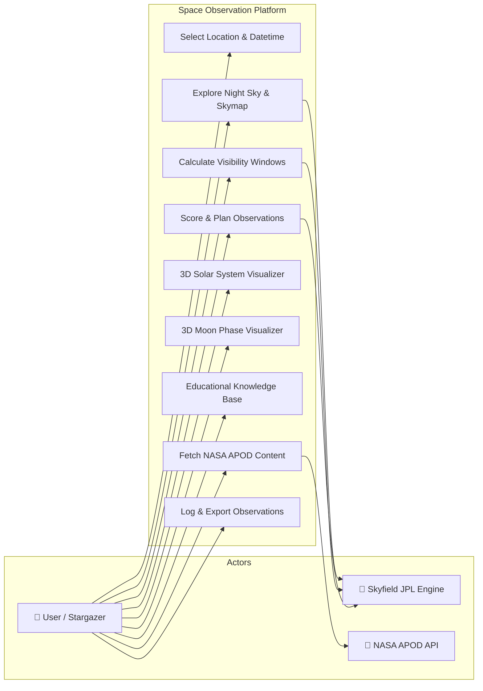
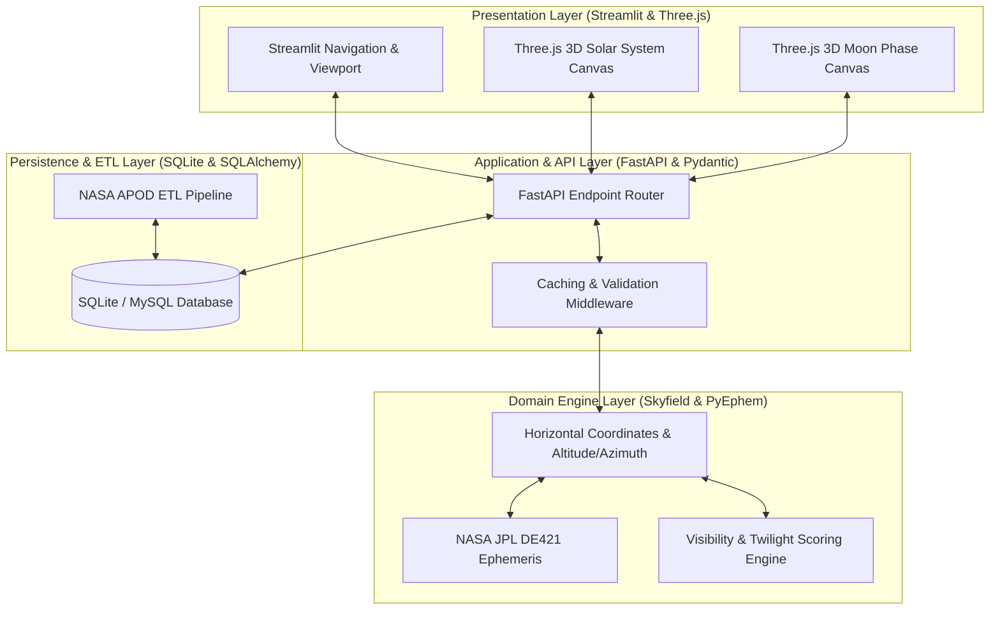

# Maharashtra Education Society’s
## Institute of Management and Career Courses (IMCC), Pune (AUTONOMOUS)
**Academic Year 2025-26 | F.Y. MCA Semester-II Course: ITP21 Mini Project**  
**Project Type: Application Development Project**

---

# SPACE OBSERVATION PLATFORM
### AI & Ephemeris-Powered Sky Exploration, Observation Planning & Educational System

**Submitted By:**
- **2501149 – Nimish Powar**
- **2501108 – Soham Limhan**

---

## INSTITUTE CERTIFICATE

**MAHARASHTRA EDUCATION SOCIETY'S (SINCE 1860)**  
**INSTITUTE OF MANAGEMENT & CAREER COURSES (IMCC) (AUTONOMOUS)**  
*Approved by AICTE and Recognized by Savitribai Phule Pune University, Pune*  
*IMCC Campus, 131, Mayur Colony, Kothrud, Pune 411038, Maharashtra, India | Ph.: 020-2546 6271 / 73 | https://imcc.mespune.in*  
*NAAC Accredited with Grade A+*

**Ref. No. MES IMCC / 442 / 2025** &nbsp;&nbsp;&nbsp;&nbsp;&nbsp;&nbsp;&nbsp;&nbsp;&nbsp;&nbsp;&nbsp;&nbsp;&nbsp;&nbsp;&nbsp;&nbsp;&nbsp;&nbsp;&nbsp;&nbsp;&nbsp;&nbsp;&nbsp;&nbsp;&nbsp;&nbsp;&nbsp;&nbsp;&nbsp;&nbsp;&nbsp;&nbsp;&nbsp;&nbsp;&nbsp;&nbsp;&nbsp;&nbsp;&nbsp;&nbsp;&nbsp;&nbsp;&nbsp;&nbsp;&nbsp;&nbsp;&nbsp;&nbsp;&nbsp;&nbsp;&nbsp;&nbsp;&nbsp;&nbsp;&nbsp;&nbsp;&nbsp;&nbsp;&nbsp;&nbsp;&nbsp;&nbsp;&nbsp;&nbsp;&nbsp;&nbsp;&nbsp;&nbsp;&nbsp;&nbsp;&nbsp;&nbsp; **Date: 06/05/2026**

### CERTIFICATE

This is to certify that the Project entitled **“Space Observation Intelligence Platform”** is completed by **“Nimish Powar”** of M.C.A. Semester II for the Academic Year 2025-26 at MES’ Institute of Management & Career Courses (IMCC), Pune - 411038.

To the best of our knowledge, this is an original study done by the said student and important sources used by him/her have been duly acknowledged in this report.

The report is submitted as a part of course ITP21 Mini Project for the Academic Year 2025-26 as per the rules and guidelines prescribed by the institute.

| ____________________ | ____________________ | ____________________ |
| :---: | :---: | :---: |
| **Project Guide** | **Head of Department** | **External Examiner** |

---

## TABLE OF CONTENTS

| Sr. No. | Section / Topic Details | Page No. |
| :---: | :--- | :---: |
| - | Institute Certificate | i |
| **1** | **Introduction** | **1** |
| 1.1 | Project Scope | 1 |
| 1.2 | Advanced Analytics & Astronomical Engine Scope | 2 |
| 1.3 | Reporting & Data Portability Scope | 2 |
| 1.4 | UI / UX Scope | 3 |
| **2** | **Analysis and Design** | **4** |
| 2.1 | Use Case Diagrams | 4 |
| 2.2 | System Architecture & Operational Flow | 5 |
| 2.3 | Table Structure / Data Dictionary (9 Schema Tables) | 6 |
| 2.4 | Sample Input and Output Screens (7 Screen Visuals) | 9 |
| **3** | **User Manual** | **13** |
| 3.1 | Night Sky Exploration & Interactive Skymap | 13 |
| 3.2 | Observation Planner & Visibility Window Engine | 14 |
| 3.3 | Interactive 3D Solar System & Moon Phase Visualizers | 15 |
| 3.4 | Educational Discovery & NASA APOD Integration | 16 |
| 3.5 | System Validation Rules & Operational Guidelines | 17 |
| **4** | **Technology Stack** | **18** |
| 4.1 | Frontend User Interface Stack | 18 |
| 4.2 | Backend Server & Astronomy Engine Stack | 18 |
| 4.3 | Database, ETL & Infrastructure Stack | 19 |
| **5** | **System Architecture** | **20** |
| **6** | **Applications and End Users** | **21** |
| **7** | **Conclusion** | **22** |
| **8** | **Future Scope** | **23** |

---

## 1. Introduction

In observational astronomy, discovering when and where celestial bodies are visible requires precise orbital mechanics, JPL ephemeris calculations, and location-aware spatial analysis. Beginners, students, and amateur astronomers frequently face fragmented tools that either provide raw mathematical data without visual context or purely aesthetic sky maps without practical observation planning tools.

The **Space Observation Platform** is an end-to-end full-stack data-driven web application designed to help users explore the night sky based on geographic coordinates, date, and time. It integrates astronomical data from trusted scientific sources (NASA APOD API, JPL DE421 Ephemeris), computes real-time celestial positions, recommends optimal observation windows, and delivers interactive 3D WebGL visualizations alongside educational explanations.

### 1.1. Project Scope
The platform is structured into five core functional pillars:
1. **Real-Time Night Sky Exploration:** Interactive Sky Map allowing real-time mapping of planets, stars, and constellations tailored to any latitude, longitude, and timestamp.
2. **Ephemeris & Astronomical Engine:** Mathematical computation of planetary coordinates, solar positions, twilight boundaries (civil, nautical, astronomical), and lunar illumination phases.
3. **Observation Planner & Visibility Engine:** Algorithmic scoring of celestial observation windows based on object altitude, sun illumination, weather factors, and lunar interference.
4. **Interactive 3D WebGL Simulators:** Three.js WebGL interactive 3D simulations of the Solar System orbital mechanics and Moon phase illumination geometry.
5. **Educational Discovery & NASA APOD ETL:** Comprehensive celestial knowledge base, structured astronomical topic guides, and daily NASA Astronomy Picture of the Day (APOD) metadata extraction.

### 1.2. Advanced Analytics & Astronomical Engine Scope
- **Skyfield Ephemeris DE421 Integration:** High-accuracy positioning using the Skyfield Python library and NASA JPL DE421 ephemeris datasets for 8 major planets, the Sun, and the Moon.
- **Visibility & Planner Scoring Algorithm:** Deterministic scoring (0–100) evaluating celestial altitude (minimum 15° horizon clearance), sky darkness (astronomical twilight vs day), lunar phase brightness, and object visual magnitude.
- **Solar & Twilight State Analyzer:** Automated calculation of sunrise, sunset, solar noon, and precise civil (-6°), nautical (-12°), and astronomical (-18°) twilight timestamps for any location.
- **Celestial Event Tracker:** Automated tracking and listing of upcoming conjunctions, planetary oppositions, meteor showers, and lunar/solar eclipses.

### 1.3. Reporting & Data Portability Scope
- **Observation Itinerary Export:** Exporting generated observation itineraries, visible object schedules, and planet visibility windows into standardized JSON and structured data tables.
- **NASA APOD Data Pipeline:** Automated pipeline fetching, processing, and storing historical and daily NASA APOD images, descriptions, and high-resolution media URLs.
- **API Cache Infrastructure:** Built-in client and backend API caching layer to optimize expensive ephemeris computations and external HTTP requests.

### 1.4. UI / UX Scope
- **Dark Sky Aesthetic:** High-contrast dark sky theme optimized for stargazers, preventing night-vision loss during field observation.
- **Responsive Dashboard Grid:** Responsive multi-page layout built using Streamlit, featuring top navigation, location selectors, search auto-complete, and interactive data cards.
- **Interactive WebGL Visuals:** Embedded Three.js WebGL canvas instances rendering interactive, zoomable, and rotatable 3D orbital models directly in the web browser.

---

## 2. Analysis and Design

### 2.1 Use Case Diagram

The system interacts with Primary Users (Stargazers, Students, Educators) and External Data Services (Skyfield JPL Ephemeris Engine, NASA APOD REST API).

**Fig 2.1.1 Use Case Diagram**

---

### 2.2 System Architecture & Operational Flow

**Fig 2.2.1 System Architecture Diagram**

---

### 2.3 Table Structure / Data Dictionary

#### Table 2.3.1: users
| Field | Type | Description |
| :--- | :--- | :--- |
| `id` | INTEGER (PK) | Surrogate primary key |
| `username` | VARCHAR(64) | Unique user handle |
| `email` | VARCHAR(255) | User email address |
| `is_active` | BOOLEAN | Account active flag |
| `created_at` | DATETIME | Record creation timestamp |
| `updated_at` | DATETIME | Record update timestamp |

#### Table 2.3.2: planets
| Field | Type | Description |
| :--- | :--- | :--- |
| `id` | INTEGER (PK) | Surrogate primary key |
| `name` | VARCHAR(64) | System identifier name |
| `display_name` | VARCHAR(128) | Human readable display name |
| `category` | VARCHAR(64) | Terrestrial / Gas Giant / Ice Giant |
| `description` | TEXT | Detailed astronomical profile |
| `mass_kg` | FLOAT | Mass in kilograms |
| `radius_km` | FLOAT | Volumetric mean radius in km |
| `semi_major_axis_au` | FLOAT | Orbital distance in AU |
| `orbital_period_days` | FLOAT | Orbital revolution period in days |
| `mean_density_g_cm3` | FLOAT | Density in g/cm³ |
| `source_url` | TEXT | Reference source URL |
| `is_active` | BOOLEAN | Active visibility flag |
| `created_at` | DATETIME | Record creation timestamp |
| `updated_at` | DATETIME | Record update timestamp |

#### Table 2.3.3: celestial_events
| Field | Type | Description |
| :--- | :--- | :--- |
| `id` | INTEGER (PK) | Surrogate primary key |
| `event_type` | VARCHAR(64) | Conjunction / Opposition / Shower / Eclipse |
| `title` | VARCHAR(255) | Event headline title |
| `description` | TEXT | Full event summary & viewing advice |
| `starts_at` | DATETIME | Event window start timestamp |
| `ends_at` | DATETIME | Event window end timestamp |
| `visible_from` | VARCHAR(255) | Geographic region visibility |
| `source_url` | TEXT | Reference source link |
| `is_recurring` | BOOLEAN | Annual recurrence flag |
| `planet_id` | INTEGER (FK) | Associated planet ID reference |
| `created_at` | DATETIME | Record creation timestamp |
| `updated_at` | DATETIME | Record update timestamp |

#### Table 2.3.4: educational_categories
| Field | Type | Description |
| :--- | :--- | :--- |
| `id` | INTEGER (PK) | Surrogate primary key |
| `slug` | VARCHAR(128) | URL slug identifier |
| `name` | VARCHAR(128) | Category title |
| `description` | TEXT | Category summary |
| `created_at` | DATETIME | Creation timestamp |

#### Table 2.3.5: educational_content
| Field | Type | Description |
| :--- | :--- | :--- |
| `id` | INTEGER (PK) | Surrogate primary key |
| `category_id` | INTEGER (FK) | Parent category ID reference |
| `title` | VARCHAR(255) | Article title |
| `slug` | VARCHAR(128) | URL slug handle |
| `excerpt` | TEXT | Short article summary |
| `body` | TEXT | Markdown full content |
| `source_url` | TEXT | Attribution URL |
| `is_featured` | BOOLEAN | Featured badge flag |
| `created_at` | DATETIME | Record creation timestamp |
| `updated_at` | DATETIME | Record update timestamp |

#### Table 2.3.6: nasa_apod
| Field | Type | Description |
| :--- | :--- | :--- |
| `id` | INTEGER (PK) | Surrogate primary key |
| `apod_date` | VARCHAR(10) | YYYY-MM-DD APOD date |
| `title` | VARCHAR(500) | NASA APOD title |
| `explanation` | TEXT | Scientific description text |
| `url` | VARCHAR(1024) | Standard image URL |
| `hdurl` | VARCHAR(1024) | High-definition image URL |
| `media_type` | VARCHAR(32) | image / video |
| `copyright_text` | VARCHAR(500) | Image copyright holder |
| `thumbnail_url` | VARCHAR(1024) | Video thumbnail URL |
| `source_api` | VARCHAR(64) | Data source identifier |
| `created_at` | DATETIME | Record creation timestamp |
| `updated_at` | DATETIME | Record update timestamp |

#### Table 2.3.7: observation_logs
| Field | Type | Description |
| :--- | :--- | :--- |
| `id` | INTEGER (PK) | Surrogate primary key |
| `user_id` | INTEGER (FK) | User reference ID |
| `planet_id` | INTEGER (FK) | Target planet ID |
| `event_id` | INTEGER (FK) | Target celestial event ID |
| `observed_at` | DATETIME | Observation timestamp |
| `status` | VARCHAR(32) | PLANNED / OBSERVED / MISSED |
| `notes` | TEXT | User observation field notes |
| `rating` | INTEGER | Observation rating (1 to 5 stars) |
| `created_at` | DATETIME | Log creation timestamp |

#### Table 2.3.8: application_settings
| Field | Type | Description |
| :--- | :--- | :--- |
| `id` | INTEGER (PK) | Surrogate primary key |
| `key` | VARCHAR(128) | Setting key handle |
| `value` | TEXT | Setting value string |
| `description` | TEXT | Setting description |
| `user_id` | INTEGER (FK) | Optional user override |
| `created_at` | DATETIME | Creation timestamp |
| `updated_at` | DATETIME | Update timestamp |

#### Table 2.3.9: api_cache
| Field | Type | Description |
| :--- | :--- | :--- |
| `id` | INTEGER (PK) | Surrogate primary key |
| `request_key` | VARCHAR(255) | MD5 hash key of request |
| `request_url` | TEXT | Full HTTP request URL |
| `response_payload` | JSON | Cached JSON payload response |
| `created_at` | DATETIME | Cache entry timestamp |
| `expires_at` | DATETIME | Cache expiration timestamp |
| `last_accessed_at` | DATETIME | Last hit timestamp |

---

### 2.4 Sample Input and Output Screens

- **Fig 2.4.1 Landing Page & Navigation:** The main landing interface presenting featured celestial events, quick navigation controls, and instant location setup.
- **Fig 2.4.2 Interactive Night Sky Map & Position Explorer:** The night sky explorer featuring real-time horizontal coordinates (Altitude/Azimuth), planetary visibility cards, and star constellations.
- **Fig 2.4.3 Interactive 3D Solar System Simulation:** The WebGL Three.js interactive 3D Solar System simulator allowing users to rotate, zoom, and inspect real planetary orbits.
- **Fig 2.4.4 Interactive 3D Moon Phase Visualizer:** The 3D lunar illumination renderer displaying precise sub-solar point lighting, lunar age, phase percentage, and distance.
- **Fig 2.4.5 Observation Planner & Visibility Dashboard:** The algorithmic observation planner listing ranked observation target windows with suitability scores and twilight constraints.
- **Fig 2.4.6 Educational Knowledge Base & Planet Profiles:** The educational knowledge discovery page detailing physical planetary statistics, atmosphere composition, and observing tips.
- **Fig 2.4.7 NASA Astronomy Picture of the Day (APOD) Interface:** The daily APOD viewer displaying high-resolution NASA imagery, scientific explanations, copyright details, and date archives.

---

## 3. User Manual

### 3.1 Night Sky Exploration & Interactive Skymap
1. **Location Setup:** Enter latitude (-90° to +90°) and longitude (-180° to +180°) or select preset cities (e.g. Pune, London, Tokyo, New York).
2. **Date & Time Selection:** Select target date and local time using the datetime picker.
3. **Skymap Generation:** Click 'Generate Skymap' to compute planetary altitudes, azimuths, magnitudes, and constellations.
4. **Reading Coordinates:** Inspect horizontal coordinates: Altitude > 0° indicates object is above the horizon; Altitude > 15° indicates prime viewing altitude.

### 3.2 Observation Planner & Visibility Scoring Engine
1. **Window Calculation:** The engine queries planetary positions throughout the night.
2. **Suitability Scoring:** Scores each target from 0 to 100 based on target altitude, solar twilight state, and lunar interference.
3. **Score Classification:** Targets scoring >= 75 are highlighted as 'EXCELLENT', 50–74 as 'GOOD', and < 50 as 'POOR'.

### 3.3 Interactive 3D Solar System & Moon Phase Simulators
- **3D Solar System:** Launch the embedded WebGL canvas to inspect 3D planetary orbits. Left-click drag to orbit camera, scroll to zoom, right-click drag to pan.
- **3D Moon Phase:** Render 3D Moon model showing real-time lunar illumination, waxing/waning phase percentage, and solar position relative to Earth.

### 3.4 Educational Discovery & NASA APOD Integration
- **Knowledge Base:** Browse curated categories: Solar System, Deep Sky, Observational Techniques, and Planetary Science.
- **NASA APOD Viewer:** Fetch NASA APOD imagery for today or any historical date with complete scientific explanations.

### 3.5 System Validation Rules & Operational Guidelines
- **Latitude Range:** Must be a numeric float between -90.0 and +90.0.
- **Longitude Range:** Must be a numeric float between -180.0 and +180.0.
- **Timestamp Format:** Must conform to ISO-8601 formatting (YYYY-MM-DDTHH:MM:SS).
- **Visibility Threshold:** Target altitude must exceed 0° to be visible; recommended minimum altitude is 15°.

---

## 4. Technology Stack

### 4.1 Frontend User Interface Stack
- **Core Framework:** Streamlit 1.35+ (Python Web Framework)
- **Web Technologies:** HTML5, CSS3, Modern JavaScript ES6
- **3D Graphics Engine:** Three.js (WebGL 3D Rendering Library)
- **Styling & Aesthetics:** Custom Dark Sky CSS with Glassmorphism Cards

### 4.2 Backend Server & Astronomy Engine Stack
- **API Framework:** FastAPI 0.110+ (Python Asynchronous Web Framework)
- **Server Gateway:** Uvicorn (ASGI High-Performance Server)
- **Data Validation:** Pydantic v2 (Data Validation & Serialization)
- **Astronomy Calculation Engine:** Skyfield 1.48+ & PyEphem (Precision Astronomy Engines)
- **Orbital Ephemeris Dataset:** NASA JPL DE421 Ephemeris Data File

### 4.3 Database, ETL & Infrastructure Stack
- **Relational Database:** SQLite 3 / MySQL Compatible Engine
- **ORM Mapping Layer:** SQLAlchemy 2.0 ORM (Object Relational Mapper)
- **Database Migrations:** Alembic (Database Schema Migration Engine)
- **ETL Infrastructure:** Custom Asynchronous NASA APOD ETL Pipeline
- **Testing Framework:** Pytest 9.0+ Test Suite (Unit & Integration Testing)
- **Deployment & DevOps:** Docker & Docker Compose Containerization

---

## 5. System Architecture

The Space Observation Platform utilizes a clean, decoupled 4-tier architecture designed for low latency astronomical computation and reliable payload delivery:
1. **Presentation Layer:** Streamlit UI renders responsive viewports, handles user input forms, and hosts Three.js WebGL canvas views.
2. **Application API Layer:** FastAPI REST service exposes documented OpenAPI endpoints, validates payloads via Pydantic, and manages caching.
3. **Domain Engine Layer:** Core astronomy service integrates Skyfield and JPL DE421 ephemeris to compute body vectors, horizontal coordinates, twilight times, and visibility scores.
4. **Persistence Layer:** SQLAlchemy ORM persists celestial reference metadata, educational articles, observation logs, and cached API responses.

---

## 6. Applications and End Users

- **Educational Institutions & Students:** Students learning solar system mechanics, moon phases, and star constellations through interactive visual tools.
- **Amateur Astronomers:** Stargazers and telescope owners planning observation sessions around optimal visibility windows.
- **Astrophotographers:** Astrophotographers tracking planet altitudes and dark sky twilight periods for long-exposure imaging.
- **Public Astronomy Clubs:** Science museums, planetariums, and astronomy clubs conducting public outreach stargazing events.

---

## 7. Conclusion

The Space Observation Platform successfully fulfills the requirements of an advanced Application Development Project by delivering a full-stack, data-driven astronomical intelligence platform.

By combining high-precision JPL ephemeris mathematical engines with modern interactive web technologies (FastAPI, Streamlit, Three.js), the platform bridges the gap between complex orbital mechanics and user-friendly sky observation.

---

## 8. Future Scope

- **Computerized Telescope Control (GOTO):** Integration with ASCOM / INDI protocols to automatically point computerized GOTO telescope mounts at selected target coordinates.
- **Satellite & ISS Tracking:** Real-time orbital propagation and pass predictions for low Earth orbit satellites including ISS and Hubble.
- **Real-Time Meteorological Integration:** Integration of cloud cover, humidity, and atmospheric seeing predictions into the observation planner scoring model.
- **Mobile Native AR Application:** Native iOS and Android mobile app development with AR (Augmented Reality) sky pointing capabilities.
